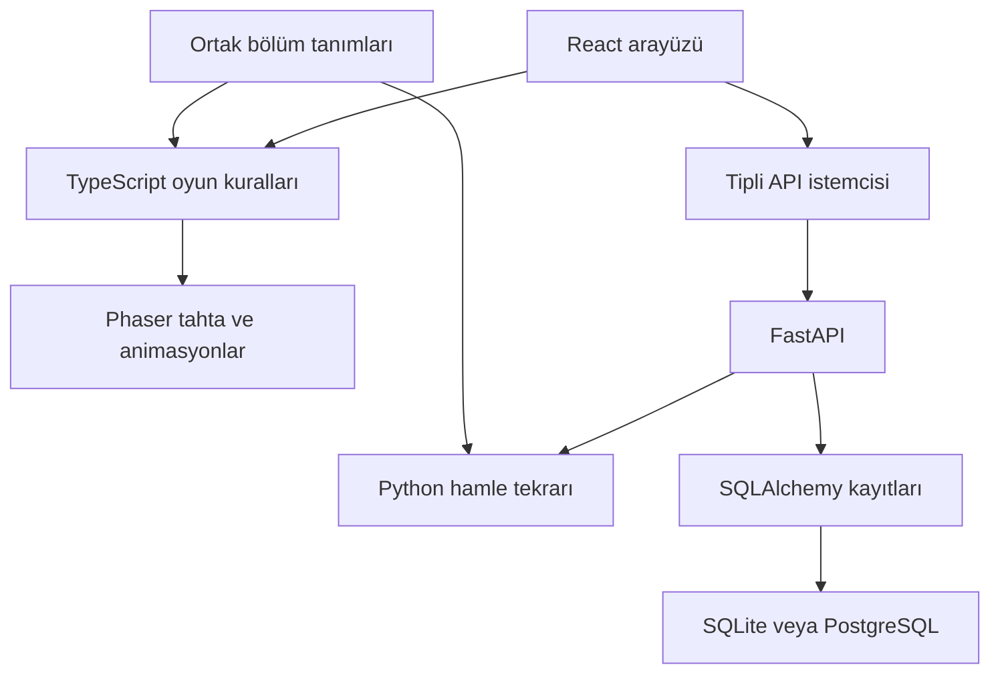

# Sweet Odyssey

**Şeker adalarında, 20 bölümlük özgün bir eşleştirme macerası.**

Türkçe arayüz; gerçek match-3 kuralları; altı farklı şeker; zincirleme patlamalar; özel şekerler; bölüm haritası ve kalıcı ilerleme. Oyun arayüzünün derlenmiş hali bu pakette hazırdır.

## Hemen oyna — Windows

1. ZIP dosyasına sağ tıklayıp **Tümünü ayıkla** seçeneğiyle bir klasöre çıkar.
2. `sweet-odyssey` klasörüne gir.
3. **`OYUNU_BASLAT.bat` dosyasına çift tıkla.**
4. İlk kurulumun bitmesini bekle. Oyun hazır olunca tarayıcı otomatik açılır.

Bilgisayarında **Python 3.11 veya üzeri** bulunmalı. İlk açılışta Python paketlerinin indirilebilmesi için internet gerekir; sonraki açılışlarda paketler tekrar indirilmez. Oynarken terminal penceresini açık bırak. Kapatmak için `Ctrl+C` kullan.

Terminalden tek komutla da başlatabilirsin:

```bash
python app.py
```

Node.js, npm, Docker, PostgreSQL kurulumu veya bir derleme adımı **oynamak için gerekmez**. `.env` dosyası oluşturmadan çalışır. Python ortamı proje içindeki `.venv` klasöründe, oyun kayıtları `data/sweet-odyssey.db` dosyasında tutulur.

Tarayıcı kendiliğinden açılmazsa terminalde yazan adresi aç: varsayılan **http://127.0.0.1:8000**. Bu adres doluysa başlatıcı 8001–8010 arasındaki uygun bir bağlantı noktasını seçer.

### macOS / Linux

```bash
python3 app.py
```

`bash baslat.sh` komutu da kullanılabilir. Bazı Linux dağıtımlarında Python'un `venv` ve `pip` bileşenlerinin ayrıca kurulması gerekebilir.

### Başlatma seçenekleri

```bash
python app.py --port 8011
python app.py --no-browser
```

`--port` ile seçilen bağlantı noktası doluysa başlatıcı açık bir hata verir. Sunucu varsayılan olarak yalnızca kendi bilgisayarından erişilebilen `127.0.0.1` adresini dinler.

## Nasıl oynanır?

**Komşu iki şekere sırayla tıkla veya bir şekeri komşusuna doğru kaydır.** Yatay ya da dikey en az üç aynı şekeri eşleştir. Eşleşmeyen takas geri alınır ve hamle harcamaz.

| Öğe | Davranış |
| --- | --- |
| Üçlü eşleşme | Şekerler patlar; üsttekiler düşer ve yeni şekerler gelir. |
| Dörtlü eşleşme | Eşleşme yönüne göre satır veya sütun temizleyen çizgili şeker oluşur. |
| Beşli / kesişen eşleşme | Bir renk bombası oluşur. Komşu bir şekerle değiştirince o rengi temizler. |
| Özel şekerler | Birbirini tetikleyebilir; iki özel şekeri komşu takas etmek de çalışır. |
| Krema | Hücrenin üzerinde sabit kalır. O hücrede bir şeker patladığında bir katman kalkar. Çift katman iki patlama ister. |
| Zincirleme eşleşme | Düşüşten sonra oluşan eşleşmeler kendiliğinden çözülür; puan çarpanı yükselir. |
| Hamle kalmaması | Bütün hedefler tamamlanmadıysa bölüm biter. Son hamlede bütün hedefler tamamlandıysa bölüm kazanılır. |
| Geçerli hamle kalmaması | Tahta otomatik karıştırılır. Bu otomatik işlem yardım hakkını tüketmez. |

Bölümü tamamlamak için **puan hedefi, varsa renk toplama hedefleri ve bütün krema katmanları birlikte** tamamlanmalı. Yıldızlar bölümdeki gerçek puana göre verilir. Kazanılan bölüm bir sonrakini açar; tamamlanmış bölümler daha iyi bir sonuç için tekrar oynanabilir.

Her denemede ücretsiz olarak birer kez:

- **Çekiç:** Seçtiğin şekeri kaldırır; o hücrenin krema katmanına da etki eder.
- **Karıştır:** Şekerleri yeniden düzenler ve oynanabilir bir tahta sağlar.
- **+5 hamle:** Beş hamle ekler. Hak duruyorsa hamlelerin bittikten sonra da devam edebilirsin.

Satın alma, reklam veya sanal para gerektiren bir işlem yoktur. İpucu düğmesi geçerli bir eşleşme gösterir. Duraklatma sırasında tahtaya giriş kapatılır. Klavye ile tahtaya odaklandıktan sonra **ok tuşları** ve **Enter / Boşluk** kullanılır; arayüz düğmelerinde **Tab** ile ilerlenebilir.

## Oyuncu ve kayıtlar

Misafir profil ilk açılışta otomatik oluşur. E-posta veya hesap açma gerekmez. Oyuncu adı, ses, müzik ve hareket tercihleri ayarlardan yönetilir. Görseller ve Web Audio ile üretilen sesler projeye dahildir; oyun sırasında bir CDN veya font servisine bağlanılmaz.

**Tamamlanan bölümler, en iyi puanlar ve yıldızlar** Python sunucusunda kaydedilir. Tarayıcıdaki misafir anahtarı bu kayda erişir. Aynı tarayıcıyı, aynı adresi (örneğin `127.0.0.1:8000`) ve aynı proje klasörünü kullanmak ilerlemeyi korur. Tarayıcı verilerini silmek, `localhost` gibi başka bir adrese geçmek veya farklı bir tarayıcı kullanmak ayrı bir misafir profili oluşturabilir. Oyunu kapattıktan sonra `data` klasörünü yedekleyebilirsin; erişim için tarayıcı profilinin de korunması gerekir.

Devam eden bir bölüm için tam oyun oturumu geri yükleme garantisi verilmez: sayfa yenilenirse o denemeyi yeniden başlatman gerekebilir. **Devam et**, son açılan bölüme götürür. Kalıcı kaydı tamamlanamayan bir galibiyet için arayüz tekrar deneme seçeneği sunar.

Sunucuya ulaşılamazsa yerel oynama seçeneği bulunur. Yerel modun ilerlemesi tarayıcıda ayrı tutulur ve arayüzde belirtilir; doğrulanmış sunucu ilerlemesiyle otomatik birleştirilmez.

## Bölümler

`shared/levels.json` içindeki **20 bölümün tamamı oynanabilir**. Dört bölge vardır: Şeker Kıyısı, Lokum Korusu, Karamel Zirveleri ve Yıldız Şatosu. İlk bölümler eşleştirmeyi öğretir; sonraki bölümler toplama hedefleri, altıncı renk ve çok katmanlı krema ekler. Son bölümler dikkatli hamle planlaması gerektirir.

Her tanım; tahta boyutu, kullanılabilir renk sayısı, hamle sınırı, puan ve toplama hedefleri, krema konumları, zorluk ve üç yıldız eşiğini içerir. Yeni bölüm eklerken kimlikleri 1'den başlayarak kesintisiz sürdür. Hem Python hem TypeScript motoru tanımları doğrular. Düzenleme sonrası ön yüzü yeniden derle.

## Mimari



Animasyonlar oyun sonucunu belirlemez. Motor önce mantıksal sonucu ve animasyon karelerini üretir; Phaser bu kareleri gösterir. Tahta çözülürken üst üste hamle verilmez.

Sunucu her deneme için bir rastgelelik tohumu ve bölüm anlık görüntüsü oluşturur. Tarayıcı sonuç kaydederken **puan göndermez; yaptığı hamleleri gönderir**. Python aynı başlangıçtan bu hamleleri yeniden oynar, geçerliliği, puanı, hedefleri ve sonucu hesaplar. Bu yüzden istemciden keyfî bir puan veya açılan bölüm değeri göndererek kayıt üretilemez. Yinelenen kayıt istekleri tutarlıdır; başka oyuncuya ait denemeye erişim reddedilir.

Bu doğrulama rekabetçi bir oyunda bot kullanımını engelleyen kapsamlı bir sistem değildir. Denemenin tohumu ve kuralları istemcide bulunduğundan otomasyon hâlâ mümkündür. Ürün yerel, misafir odaklı bir oyundur.

### Teknoloji tercihleri

| Katman | Kullanım |
| --- | --- |
| React + strict TypeScript | Menü, harita, ayarlar, hedefler ve sonuç ekranları. |
| Vite | Geliştirme ve ZIP'e eklenen statik üretim derlemesi. |
| Phaser 3 | Tahta, pointer/touch etkileşimi, tween ve patlama efektleri. |
| Framer Motion + Lucide React | Arayüz geçişleri ve tutarlı simgeler. |
| FastAPI + Pydantic | Doğrulanan HTTP istekleri ve yanıtları. |
| SQLAlchemy + SQLite | Kolay kurulumla kalıcı yerel kayıtlar. |
| PostgreSQL + Alembic | İsteğe bağlı geliştirici veritabanı ve sürümlü şema. |
| Vitest + Pytest + Playwright | Mantık, API, kayıt ve gerçek tarayıcı akışları. |

Kurulan tam sürümler `frontend/package-lock.json` ve `backend/requirements*.txt` içinde bulunur. Oyun görselleri özgün SVG çizimleridir; başka bir oyunun markası, karakteri veya görseli kullanılmaz. Üçüncü taraf lisansları `THIRD_PARTY_NOTICES.md` içinde açıklanır.

### Dosya düzeni

```text
sweet-odyssey/
  app.py                     Tek komutla başlatıcı
  OYUNU_BASLAT.bat            Windows çift tık başlatıcısı
  baslat.sh                  macOS / Linux başlatıcısı
  frontend/
    dist/                    Hazır oyun — ZIP'te bulunur
    src/                     React, Phaser ve TypeScript motoru
    public/assets/           Özgün SVG varlıkları
    tests/e2e/               Gerçek tarayıcı testleri
  backend/
    app/                     FastAPI, Python motoru ve kayıt modelleri
    tests/                   API, veritabanı ve başlatıcı testleri
    migrations/              Alembic şeması
  shared/levels.json         Ortak bölüm tanımları
  tests/                     Motor / diller arası doğrulama
  tools/                     Çizim ve paketleme yardımcıları
  docs/                      Doğrulama notları ve lisanslar
  .github/workflows/ci.yml   Otomatik kontrol iş akışı
```

## Geliştirici kurulumu

Oynamak için bu bölüme ihtiyaç yoktur. Kaynak kodu değiştireceksen **Node.js 22.12+** ve Python 3.11+ kullan.

Önce `python app.py` ile Python ortamını oluştur. Sonra ayrı bir terminalde:

```bash
cd frontend
npm ci
npm run dev
```

Vite'ın yazdığı adrese git. `/api` istekleri varsayılan olarak `127.0.0.1:8000` üzerindeki Python sunucusuna yönlenir. Farklı bir sunucu bağlantı noktası kullanıyorsan `vite.config.ts` içindeki proxy hedefini güncelle.

Ön yüz kaynaklarını değiştirdikten sonra hazır oyunu güncelle:

```bash
cd frontend
npm run build
```

Üretim derlemesi geliştirme / test denetim kancasını içermez. Derlemeden sonra kökteki `python app.py` yeni arayüzü sunar.

### Ortam değişkenleri

| Değişken | Varsayılan / işlev |
| --- | --- |
| `SWEET_PORT` | `8000`; başlatıcının başlangıç bağlantı noktası. |
| `SWEET_DATA_DIR` | Proje içindeki `data`; varsayılan SQLite dosyasının konumu. |
| `DATABASE_URL` | Boşsa SQLite; PostgreSQL için SQLAlchemy bağlantı URL'si. |
| `CORS_ORIGINS` | Boşsa aynı kaynak; gerekirse virgülle ayrılmış açık kaynak adresleri. |
| `VITE_API_BASE_URL` | `/api`; farklı API kullanımı için derleme sırasında verilir. |
| `VITE_TEST_MODE` | Normal derlemede kapalı; yalnızca tarayıcı test derlemesinde `1`. |

Kök `.env.example` dosyasını gerekirse `.env` olarak kopyala. Gerçek parolaları sürüm kontrolüne ekleme. `VITE_` ile başlayan değerler istemciye gittiği için gizli anahtar taşımaz.

## İsteğe bağlı PostgreSQL

SQLite kolay başlatma için varsayılandır. PostgreSQL kullanmak isteyen geliştirici:

1. `.env.example` dosyasını `.env` olarak kopyalar.
2. `POSTGRES_USER`, `POSTGRES_DB`, `POSTGRES_PASSWORD` ve aynı değerlerle `DATABASE_URL` tanımlar. Örnek URL biçimi dosyada vardır; kendi parolanı belirle.
3. `docker compose up -d db` komutunu çalıştırır.
4. `python app.py` komutunu çalıştırır. Başlatıcı PostgreSQL sürücüsünü de kurar.

Yerel kolay başlatıcı ilk şemayı otomatik oluşturur. Sürümlü şema kullanımı için, uygulamayı ilk kez başlatmadan önce:

```bash
# Windows: proje kökünde
python -m venv .venv
.venv\Scripts\python.exe -m pip install -r backend/requirements-postgres.txt
.venv\Scripts\python.exe -m alembic upgrade head

# macOS / Linux karşılığı
python3 -m venv .venv
.venv/bin/python -m pip install -r backend/requirements-postgres.txt
.venv/bin/python -m alembic upgrade head
```

İlk geçiş boş bir veritabanında uygulanabilir. Boş veritabanı ve otomatik oluşturulmuş ilk şema ile geçiş uyumu SQLite üzerinde test edildi; canlı PostgreSQL sunucusuyla doğrulama sınırı `docs/DOGRULAMA.md` içinde açıklanır. Mevcut kayıtlarını farklı veritabanına taşıma, bu paketin otomatik başlangıç akışının dışında kalır.

## Testler

Çalıştırılan testlerin sonuçları ve doğrulama sınırları **`docs/DOGRULAMA.md`** içinde yazılıdır. Aşağıdaki komutlar kontrolleri yeniden çalıştırır.

```bash
# Proje kökünde, Windows
.venv\Scripts\python.exe -m pip install -r backend/requirements-dev.txt
.venv\Scripts\python.exe -m pytest

# macOS / Linux
.venv/bin/python -m pip install -r backend/requirements-dev.txt
.venv/bin/python -m pytest
```

```bash
cd frontend
npm ci
npm run typecheck
npm run lint
npm test
npx playwright install chromium
npm run test:e2e
npm run build
```

Playwright testi kendi ayrı SQLite veritabanını ve 8173 bağlantı noktasında kendi test sunucusunu oluşturur. Normal oyuncu kaydını kullanmaz. Test derlemesindeki erişim yalnızca gerçek motor hamlelerini çalıştırır; puan yazma, zorla kazanma veya bölüm açma işlevi içermez. **Testten sonra `npm run build` normal dağıtım derlemesini geri oluşturur.** `SWEET_TEST_PYTHON` gerekirse testlerin kullanacağı Python çalıştırılabilir dosyasını seçer.

GitHub Actions yapılandırması; Python testlerini, TypeScript denetimini, lint, Vitest, tarayıcı akışlarını ve üretim derlemesini çalıştırmak için hazırdır. İş akışının GitHub'da çalıştırılmış olduğu ayrıca iddia edilmez.

## Dağıtım

Bu teslim bir **yerel çalıştırma paketi** içerir. Çalışan üretim derlemesi `frontend/dist` içindedir. `python tools/package_project.py` kaynakları ve bu derlemeyi ZIP'e toplar; bağımlılık klasörleri, gizli ortam dosyaları, gerçek oyun kayıtları ve test çıktıları pakete alınmaz.

Kendi sunucunda yayımlamak istersen önce ön yüzü derle, kalıcı `DATABASE_URL` yapılandır, Alembic geçişini çalıştır ve FastAPI'yi bir uygulama servisi olarak başlat. HTTPS, ters proxy ve işlem yönetimi barındırdığın ortamın sorumluluğundadır. Bu görev kapsamında çevrimiçi bir site yayımlanmadı; kullanıcı hesapları, hesap kurtarma ve cihazlar arası senkronizasyon bu sürümün kapsamına dahil değildir.

### Portföy için ekran görüntüsü kontrol listesi

- Karşılama ekranı ve çizimli ada.
- Yeni oyuncu haritasında kilitli bölümler.
- Oyun tahtası, puan, hamle ve toplama hedefleri.
- Krema ve özel şeker örnekleri.
- Bir galibiyetin yıldızları ve açılan sonraki bölüm.
- Mobil dikey görünüm.

## Sorun giderme

| Durum | Yapılacak işlem |
| --- | --- |
| Python bulunamadı | Python 3.11+ kurulu olduğunu kontrol et; `python --version` veya `py -3 --version` ile doğrula. |
| İlk kurulumda paketler indirilemiyor | İnternet / kurumun izinli paket erişimini kontrol et. Başlatıcıdaki hata metni kurulamayan paketi gösterir. |
| Oyun dosyaları eksik | ZIP'in tamamını çıkar. `frontend/dist/index.html` dosyası proje içinde bulunmalı. |
| Tarayıcı açılmadı | Terminaldeki `http://127.0.0.1:...` adresini elle aç. |
| Kayıt servisine erişilemiyor | Python penceresinin açık olduğuna bak; arayüzdeki yeniden deneme seçeneğini kullan. |
| Başka bağlantı noktası gerekiyor | `python app.py --port 8011` kullan. Farklı adresin tarayıcıda ayrı yerel depolama alanı oluşturacağını unutma. |

### Teknik başvuru

[React belgeleri](https://react.dev/) · [Vite belgeleri](https://vite.dev/guide/) · [Phaser 3.90 API](https://docs.phaser.io/api-documentation/3.90.0/api-documentation) · [FastAPI belgeleri](https://fastapi.tiangolo.com/) · [SQLAlchemy belgeleri](https://docs.sqlalchemy.org/) · [Playwright belgeleri](https://playwright.dev/docs/intro)
